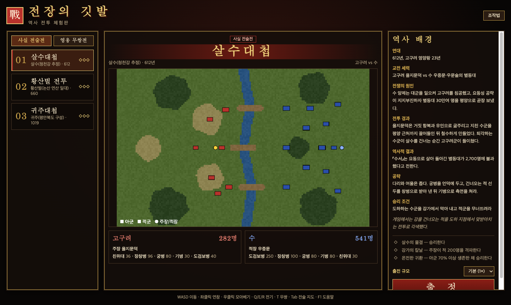
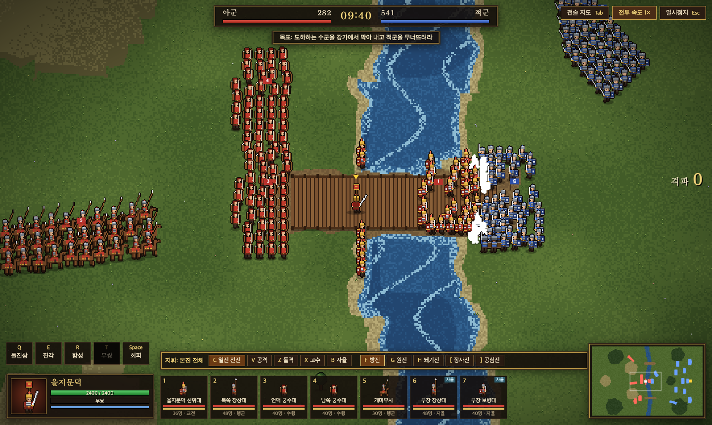
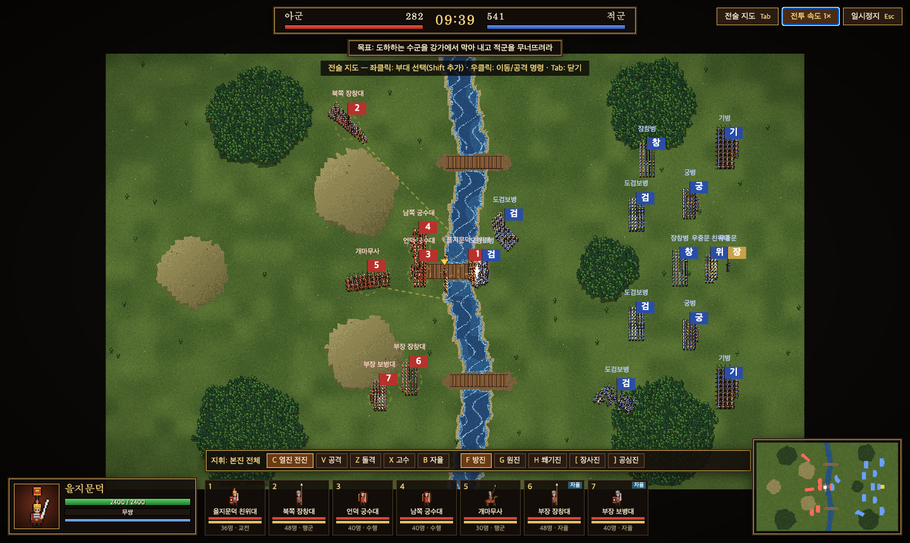
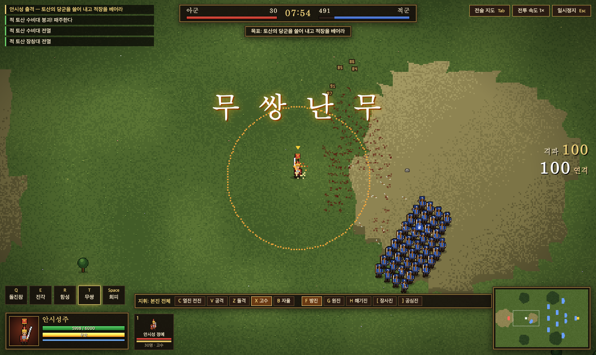
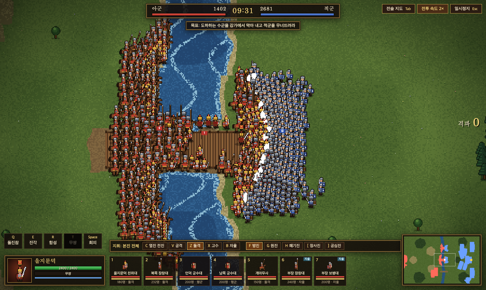

# 전장의 깃발 (Banners of War)

한국사의 네 전투를 소재로 한 브라우저 실시간 액션·군단 지휘 게임입니다. 주장 한 명을 직접 조작해 싸우면서, 동시에 부대에 명령을 내려 수적으로 우세한 적을 상대합니다.

itch.io에 공개된 *Song of Ashes — Historical Battles Demo*(JUMO GAMES)의 구성을 참고해 새로 만든 재현작입니다. 원본의 코드, 그림, 문구는 쓰지 않았습니다. 모든 그래픽은 코드로 생성합니다. 원본의 일부 기능만 구현한 축소판이며 [구현 범위](#구현-범위와-한계)에 정리했습니다.



## 실행

빌드나 설치 없이 정적 파일만으로 동작합니다.

```bash
git clone https://github.com/gyuha/ansi-battle.git
cd ansi-battle
python3 -m http.server 8000   # 또는 index.html 을 브라우저로 직접 열기
```

`http://localhost:8000` 에 접속합니다. 최신 데스크톱 브라우저와 마우스·키보드가 필요하며, 모바일 터치 조작은 지원하지 않습니다.

## 전투

| 모드 | 전투 | 시대 | 특징 |
|---|---|---|---|
| 사실 전술전 | 살수대첩 | 612 | 강과 다리 세 곳. 도하하는 수군을 막아 낸다 |
| 사실 전술전 | 황산벌 전투 | 660 | 언덕 위 세 군영을 지키며 열 배의 적과 싸운다 |
| 사실 전술전 | 귀주대첩 | 1019 | 거란 기병을 받아 내고, 2분 30초에 남풍이 불면 궁병이 강해진다 |
| 영웅 무쌍전 | 안시성 출격 | 645 | 강력한 주장과 소수 정예로 적진을 뚫고 적장을 벤다. 시간이 지나면 적 증원이 온다 |

전투마다 연대, 교전 세력, 원인, 경과, 역사적 결과와 공략을 메뉴에서 볼 수 있습니다. 병력과 장수 능력은 게임용으로 각색했으며, 각색한 부분은 각 전투 설명에 표시했습니다. 전투마다 업적이 3개 있고 진행 상황은 브라우저(`localStorage`)에 저장됩니다.



## 조작

### 주장

| 입력 | 동작 |
|---|---|
| `W` `A` `S` `D` / `Shift` | 이동 / 질주 |
| 마우스 이동 | 바라보는 방향 (8방향) |
| 좌클릭 | 3단 연참. 세 번째 타격은 적을 날려 보내고, 누르고 있으면 연속 공격 |
| 우클릭 유지 | 모아베기. 오래 모을수록 범위와 위력이 커진다 |
| `Q` | 돌진참. 적진을 꿰뚫고 지나간다 (무쌍 게이지 20) |
| `E` | 진각. 주변 적을 날려 보낸다 (무쌍 게이지 25) |
| `R` | 함성. 근처 아군의 사기 회복, 공격력 상승, 패주 부대 재집결 (무쌍 게이지 15) |
| `T` | 무쌍. 무쌍 게이지가 가득 찼을 때 |
| `Space` | 회피 (무적, 무쌍 게이지 10) |

### 부대 지휘

| 입력 | 동작 |
|---|---|
| `1`–`9` / `Shift`+`1`–`9` | 부대 선택 / 추가 선택. 선택이 없으면 부장 부대를 뺀 본진 전체에 명령한다 |
| `-` | 부장 부대까지 포함해 전군 선택 |
| `` ` `` 또는 `0` | 선택 해제 |
| `C` | 주장을 따라 열진 전진 |
| `V` | 커서 위치의 적 부대 공격. 땅을 가리키면 그곳으로 이동 |
| `Z` / `X` | 돌격 / 커서 위치 고수 |
| `B` | 자율 지휘 전환 (다시 누르면 회수) |
| `F` `G` `H` `[` `]` | 방진 / 원진 / 쐐기진 / 장사진 / 공심진 |
| `Tab` | 전술 지도. 좌클릭으로 부대 선택, 우클릭으로 명령 |
| 마우스 휠 | 확대·축소 |
| `Esc` / `F1` | 일시정지 / 조작법 |



## 규칙

- **주장:** 체력이 낮고 받는 피해가 커서 적진에 뛰어들면 몇 초 만에 쓰러지고, 쓰러지면 패배한다. 공격은 가까운 몇 명에게만 피해를 주지만 **넉백은 범위 안의 모두에게** 적용되므로, 적을 베기보다 밀어내 전선을 흔드는 쪽이 효과적이다.
- **병종:** 도검보병, 장창병, 궁병, 기병, 친위대. 장창병은 기병에 강하고, 기병은 달리는 중에 돌격하면 피해가 크게 늘어난다.
- **진형:** 처음에는 효과가 없는 자유 진형이고, 직접 고르면 효과가 생긴다. 방진은 받는 피해 20% 감소, 원진은 받는 피해 10% 감소에 화살 피해 추가 35% 감소, 쐐기진은 근접 공격력 25% 증가에 받는 피해 15% 증가, 장사진은 공격력 20% 감소에 받는 피해 10% 증가, 공심진은 받는 피해 10% 감소에 공격력 10% 감소이다.
- **고수와 측후면:** 고수(`X`) 명령을 내려 자리를 지키는 부대는 받는 피해가 30% 줄어든다. 처음 배치에는 이 효과가 없다. 언덕 위에서도 받는 피해가 30% 줄어든다. 상대가 바라보는 방향의 옆(1.25배)이나 뒤(1.5배)에서 치면 근접 피해가 커진다.
- **사기:** 부대는 손실이 커지면 사기가 떨어져 패주하고, 주변에 적이 없으면 다시 모인다. 적장을 베면 적 전군의 사기가 크게 꺾인다. 주장이 가까이 있으면 아군 사기가 오른다.
- **지형:** 숲은 이동이 느리고 화살 피해가 줄어든다. 강은 다리로만 건널 수 있다.
- **지휘 범위:** 주장 주변 320 이내에 있는 부대만 제 능력을 낸다. 범위 밖(카드에 "지휘밖" 표시)의 부대는 공격력이 30% 줄고 받는 피해가 25% 늘며 사기가 계속 떨어진다. 주장 주위의 점선 원이 범위이고, 부장 부대는 항상 범위 안으로 본다. 부대에 명령만 내리고 주장을 가만히 두면 대부분의 부대가 범위 밖이 된다.
- **승패:** 승리는 **적장을 베는 것**뿐이다. 적을 패주시켜도 사기를 되찾고 돌아오므로 끝나지 않는다. 주장이 쓰러지거나 아군이 모두 무너지거나 제한 시간이 끝나면 패배한다.



## 출전 규모 옵션

메뉴의 "출전 규모"에서 **1×(기본), 2×, 3×, 4×, 5×(대군)** 중 고를 수 있습니다. 아군과 적군의 모든 부대와 적 증원군이 같은 배율로 늘어나고, 적장은 1명 그대로입니다. 살수대첩 기준 1×는 282명 대 541명, 3×는 846명 대 1,621명, 5×는 1,410명 대 2,701명입니다. "적 N명 격파" 업적의 기준도 배율만큼 커집니다. 배율이 클수록 주장 주변의 적도 늘어나므로 부대 지휘를 더 활용해야 합니다.



## 구조

```
index.html        메뉴·HUD·오버레이 마크업
css/style.css     화면 스타일
js/data.js        병종(UNIT_TYPES)과 전투 데이터(BATTLES)
js/sprites.js     픽셀아트 스프라이트·장식 생성 (Sprites)
js/game.js        지형 생성, 부대 AI, 전투, 입력, 렌더링, 메뉴
```

게임은 고정 시간 간격(1/30초)으로 상태를 갱신하고, 매 화면 프레임마다 그립니다. 한 번의 갱신은 다음 순서로 진행됩니다.

```
이벤트(증원·남풍) → 공간 격자 갱신 → 부대 AI(0.25초마다) → 병사 이동·공격 → 겹침 해소 → 주장 갱신 → 투사체·효과 → 승패 판정
```

- **지형:** 20단위 셀 격자를 만들고, 전투용 픽셀 지형 이미지는 시작할 때 한 번만 그려 둡니다. 강을 건너야 하는 부대는 가장 가까운 다리를 경유합니다.
- **스프라이트:** 사람 모양은 오른쪽·정면·뒷모습·대각선 두 방향을 코드로 그립니다. 나머지 방향은 좌우를 뒤집어 만듭니다. 외곽선, 패주(회색), 피격(흰 실루엣) 변형은 자동으로 생성해 캐시합니다.
- **효과:** 베기 궤적, 충격파, 화살, 타격 불꽃, 무쌍 불씨, 피해 숫자를 모두 픽셀 단위로 그립니다.

새 전투는 `js/data.js`의 `BATTLES` 배열에 같은 형식으로 항목을 추가하면 메뉴에 나타납니다.

## 구현 범위와 한계

원본에 있고 이 프로젝트에 **없는** 것:

- 장수 만들기(초상화, 장비, 문장 편집)와 무기별 기술, 무기 교체
- 병종 도감, 20개 전투, 100개 업적
- 성문·본성 점령 같은 공성 전투
- 모바일 터치 조작, 키 설정 변경, 영어 지원, 사운드

알려진 한계:

- 대각선 방향의 기병은 말이 옆모습 그대로이고 기수만 3/4 시점입니다.
- 난이도는 자동 실행(봇)으로만 조정했고, 사람이 끝까지 플레이해 맞춘 값이 아닙니다. 모든 전투에서 아군은 열세입니다. 부대에 방어 명령만 내리고 주장을 가만히 두는 경우는 모든 전투에서 졌고, 주장이 주력 부대를 따라가며 적장을 노리는 봇은 일부 시도에서 이겼습니다. 다만 이후에 바꾼 전술전 주장 HP(300)·전술전 무쌍 피해(1/3)·기술의 무쌍 게이지 소모는 봇으로 다시 검증하지 않았습니다.
- 5× 규모에서 전술 지도(`Tab`)는 약 86fps로, 일반 화면보다 낮습니다. (헤드리스 Chromium, 1440×860 기준)
